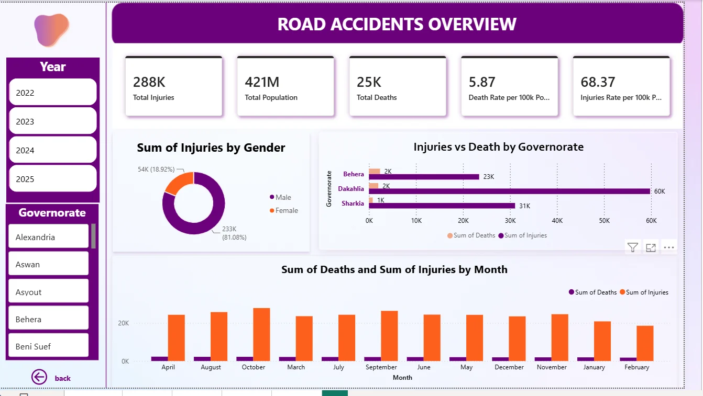
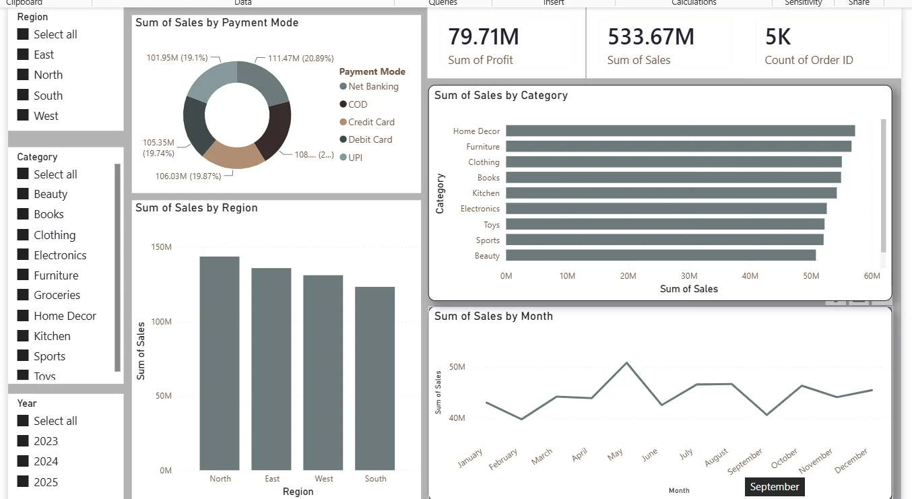
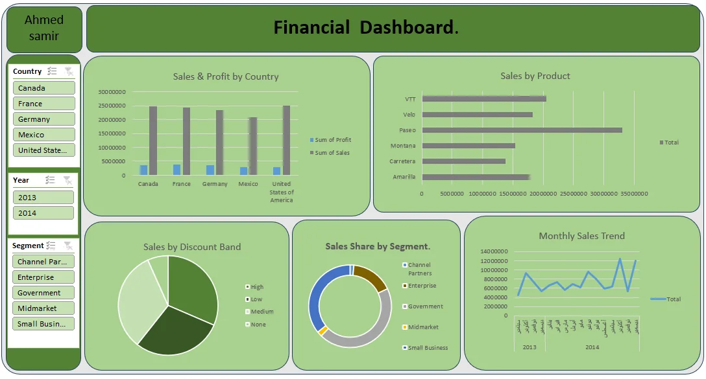
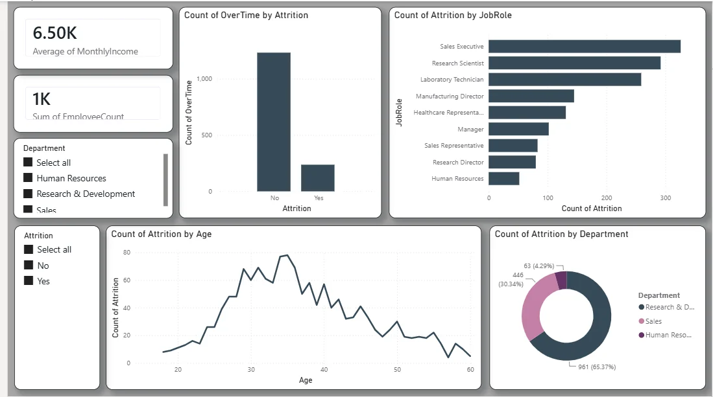

# Hi, I'm Ahmed Samir 👋

**Data Analytics · Business Intelligence · Data Science + AI**
*Turning data into insight.*

Fourth-year Computer Science student at Zagazig University (expected June 2027), building a data analyst career with SQL, Power BI, Excel and Python.

🌐 **Portfolio:** `<ضع هنا رابط GitHub Pages الخاص بالبورتفوليو>`
💼 **LinkedIn:** [ahmed-samir-analytic](https://www.linkedin.com/in/ahmed-samir-analytic/)

---

## 🎯 What I do
- Clean and prepare messy data (Excel, CSV, Python/Pandas, Power Query)
- Write SQL over fact and dimension tables (MySQL)
- Build Power BI and Excel dashboards with slicers and clear KPIs
- Explain what the data showed in plain language

## 📈 Featured work
| Project | What it is | Tools |
|---|---|---|
| **Road Traffic Accidents Analysis** (team project, NTI) | Egypt road injuries and deaths, 2022–2025, 4-page Power BI dashboard. **My part: the SQL analysis.** | MySQL, Power BI, Pandas, Power Query |
| **Excel Dashboards** | Financial and Sales/Profit dashboards with slicers | Excel, Power Query, PivotCharts |
| **Power BI Practice Dashboards** | E-commerce sales and employee attrition | Power BI |

### Dashboard previews

## 🎓 Training & Certificates
- **NTI × ITIDA Data Analytics Summer Training**: 120 hours, 100% final score (Jul–Aug 2026)
- **McKinsey.org Forward Program**: Foundational Skills (Oct–Dec 2026)
- Link · eYouth: Business Intelligence and Data Analysis
- HP LIFE: Data Science and Analytics
- DeepLearning.AI: AI for Everyone · Google Cloud: Intro to Generative AI
- ICPC Zagazig Community: Level 0

## 🧰 Tools

Also: Power Query · C++ · Tableau (training) · SQL Server (training) · Git

## 📫 Open to
Trainee roles and small freelance projects in data analytics / BI.
Fastest way to reach me: [LinkedIn](https://www.linkedin.com/in/ahmed-samir-analytic/)
